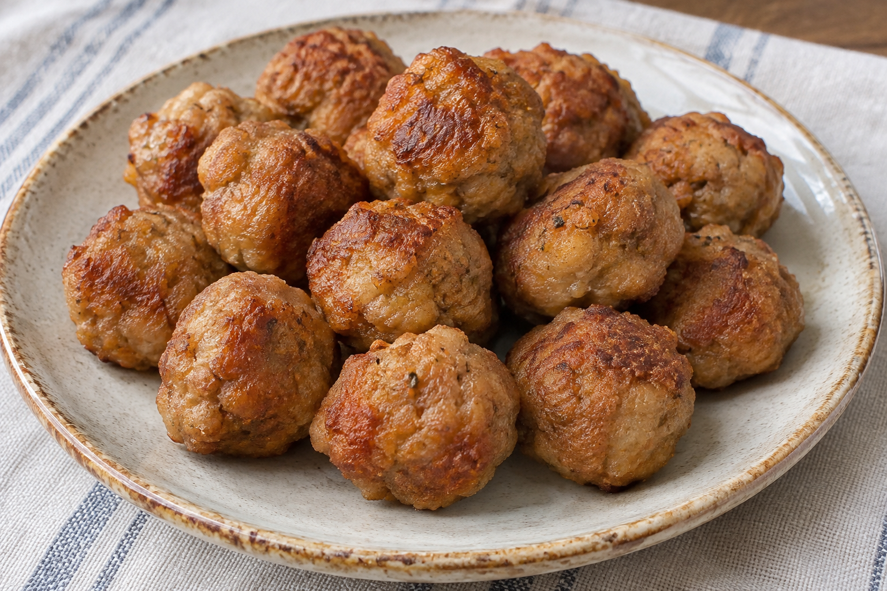

# Albóndigas caseras

**Receta:** 20 · **Chef:** Abuela Loli · **Raciones:** ~4 · **Dificultad:** media · **Tiempo:** ~40 min

## Ingredientes

Para ~4 personas; cantidades orientativas salvo la carne, los huevos y el ajo.

- Carne picada de ternera y cerdo: 500 g
- Huevos: 2
- Cebolla: ~1/2 unidad
- Ajo: 1 diente
- Perejil: ~1 cucharada
- Leche: ~50 ml
- Pan rallado: el necesario
- Harina: para rebozar
- Sal y pimienta: al gusto
- Aceite de oliva: para freír

## Elaboración

1. Pica muy fina la cebolla, el diente de ajo y el perejil.
2. Bate los huevos en un bol. Añade la carne picada, la cebolla, el ajo, el perejil, sal, pimienta y un chorrito de leche. Mezcla bien.
3. Añade pan rallado poco a poco y mezcla hasta obtener una masa lo bastante consistente para formar las albóndigas.
4. Forma bolitas con la mezcla y pásalas por harina, sacudiendo el exceso.
5. Fríe las albóndigas en aceite caliente, por tandas, girándolas para que se doren y queden bien cocinadas por dentro. Retíralas y deja escurrir el exceso de aceite.

## Consejos

- Las raciones y las cantidades de cebolla, perejil y leche son orientativas.
- Comprueba que el centro alcance 71 °C con un termómetro de cocina.
- Contiene huevo, leche y gluten.
