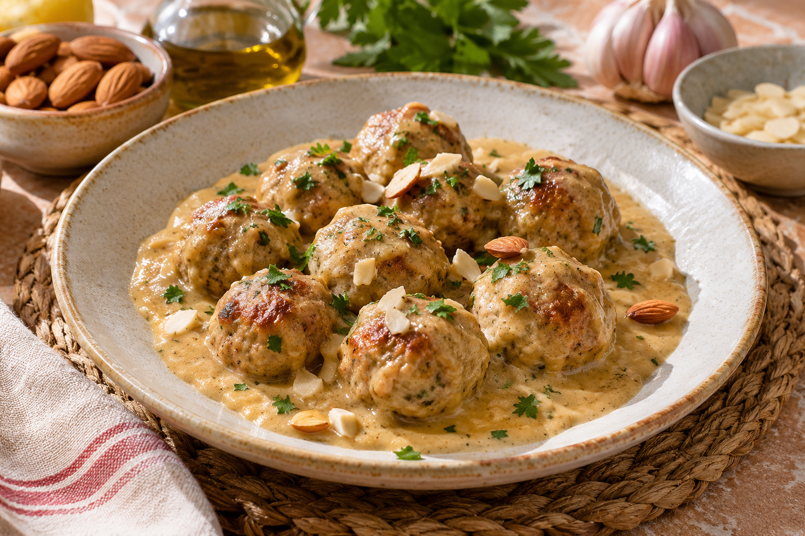

# Albóndigas en salsa de almendras

**Receta:** 6 · **Chef:** Javi · **Raciones:** 4–6 · **Dificultad:** fácil · **Tiempo total:** ~40 min

## Ingredientes para la salsa

Cantidades originales de salsa para 4–6 raciones.

| Ingrediente | Cantidad |
|---|---:|
| Aceite de oliva | 30 g |
| Almendras crudas | 50 g |
| Ajo | 1 diente grande |
| Perejil | Al gusto |
| Vino blanco | 75 g |
| Pan fresco | 30 g |
| Agua | 400 g |
| Sal | ½ cucharadita |
| Colorante alimentario | 1 pellizco, opcional |

## Elaboración

1. Pon el aceite en el vaso y calienta 5 minutos a temperatura Varoma y velocidad 1.
2. Añade el pan fresco en dados, las almendras, el ajo laminado y el perejil. Sofríe 6 minutos a temperatura Varoma y velocidad cuchara.
3. Incorpora el vino blanco y tritura 20 segundos, aumentando progresivamente de velocidad 5 a 7 y 10.
4. Agrega el agua, la sal y, si lo deseas, el colorante. Introduce en el vaso el cestillo con las albóndigas crudas ya formadas y cocina 20 minutos a temperatura Varoma y velocidad 2, con el cubilete puesto.
5. Retira con cuidado el cestillo y pasa las albóndigas a una olla. Tritura la salsa 20 segundos a velocidad 10, con precaución por el vapor caliente. Vierte la salsa sobre las albóndigas y deja que hiervan suavemente 3–4 minutos. Comprueba que estén bien cocinadas por dentro antes de servir.

## Consejos

- Necesitas tener las albóndigas crudas ya formadas antes de empezar; sus ingredientes y preparación no están incluidos en esta ficha. Hazlas pequeñas para que quepan en el cestillo.
- El colorante es opcional. Si la salsa queda demasiado espesa, añade un poco de agua y ajusta la textura.
- La dificultad es fácil por sus pasos sencillos. El tiempo total de ~40 minutos es una estimación para la salsa y la cocción, con las albóndigas ya preparadas.
