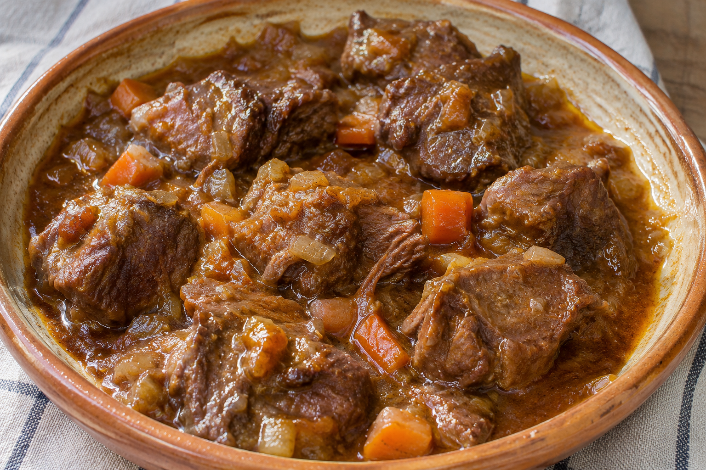

# Carrillada en Salsa

**Receta:** 18 · **Chef:** Abuela Tere · **Raciones:** 4 · **Dificultad:** media · **Tiempo:** ~2 h 30 min

## Ingredientes

Para 4 personas; cantidades orientativas salvo cuando se indica.

- Carrillada, en trozos: ~1 kg
- Cebolla: ~1 grande
- Zanahoria: ~2 medianas
- Tomate, en dados: 1
- Ajo: 1 diente
- Harina: ~2 cucharadas
- Vino blanco: ~150 ml
- Agua: la necesaria
- Laurel: ~1 hoja
- Azafrán en hebras: ~1 pizca
- Pimienta: al gusto
- Sal: al gusto
- Aceite de oliva: ~3 cucharadas

## Elaboración

1. Trocea la cebolla y la zanahoria. Corta el tomate en dados y pica el ajo.
2. Calienta el aceite en una olla y pocha primero la cebolla. Un poco después, añade la zanahoria y continúa cocinando hasta que estén pochadas.
3. Añade el tomate en dados y el ajo y mezcla con las verduras.
4. Enharina ligeramente la carrillada troceada y añádela a la olla. Remueve y deja cocinar 2 minutos.
5. Vierte un chorreón de vino blanco y añade agua hasta cubrir. Sazona e incorpora la pimienta, el azafrán en hebras y el laurel.
6. Cocina a fuego lento aproximadamente 2 horas, hasta que la carne esté tierna. Añade agua si se va consumiendo durante la cocción.

## Consejos

- Las cantidades son orientativas, salvo el tomate y el ajo indicados en la receta original.
- Comprueba la ternura de la carne; el tiempo puede variar según el tamaño de los trozos.
- Contiene gluten; el vino puede contener sulfitos.
