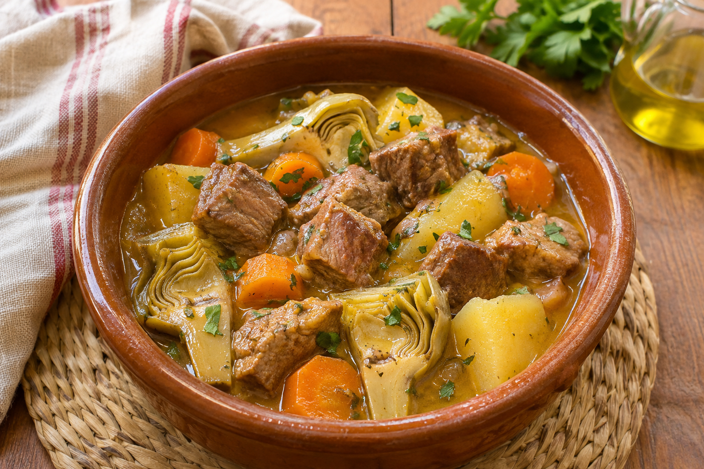

# Estofado de Carne

**Chef:** Abuela Loli  
**Raciones:** ~4  
**Dificultad:** Fácil  
**Tiempo:** ~45 min

## Ingredientes

- 500 g de carne magra de ternera o cerdo, en dados
- ~2 patatas medianas
- ~2 zanahorias
- ~2 alcachofas
- ~1 cebolla
- ~2 dientes de ajo
- 1/2 vaso de vino blanco
- Romero, laurel y clavo, al gusto
- Colorante alimentario, al gusto
- Aceite de oliva y sal, al gusto
- Agua, la necesaria para cubrir

## Elaboración

1. Pela y pica la cebolla y los ajos. Pela y trocea las zanahorias y las patatas; limpia y trocea las alcachofas.
2. En la olla exprés, prepara un refrito con aceite, cebolla, ajos y zanahoria hasta que las verduras estén pochadas.
3. Añade la carne y rehógala. Incorpora las alcachofas, las patatas, el romero, el laurel y el clavo; sazona.
4. Vierte medio vaso de vino blanco y añade el colorante. Agrega agua hasta cubrir los ingredientes, respetando el límite de llenado de la olla.
5. Cierra la olla y cocina 10 minutos desde que alcance la presión, según la receta original. Deja que pierda presión siguiendo las instrucciones de la olla antes de abrirla.
6. Comprueba que la carne esté tierna y las patatas hechas. Si necesitan más tiempo, continúa la cocción hasta que estén listas; rectifica de sal.

## Consejos

- Las cantidades indicadas con ~ y el rendimiento son orientativos: no figuran en la receta original.
- El tiempo de cocción puede variar según la carne y la olla; los 10 minutos proceden del manuscrito.
