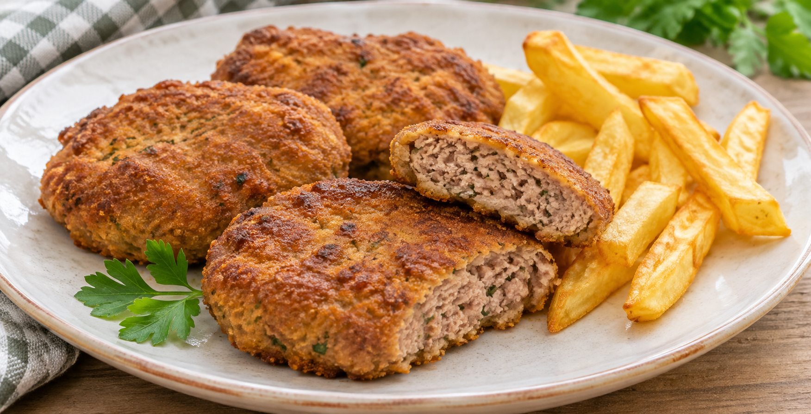

# Filetes Rusos

**Chef:** Abuela Tere  
**Raciones:** ~4  
**Dificultad:** Fácil  
**Tiempo:** ~1 h 45 min, incluido 1 h de reposo

## Ingredientes

- 400 g de carne picada de ternera
- 100 g de papada de cerdo o panceta
- 1 patata mediana
- 2 huevos
- 1 diente de ajo
- Perejil, pimienta y sal, al gusto
- Pan rallado, el necesario para dar forma
- Aceite para freír

## Elaboración

1. Pide al carnicero que pique la ternera junto con la papada o la panceta.
2. Cuece la patata en poca agua con sal hasta que esté tierna. Escúrrela y aplástala para hacer un puré espeso. Deja que se enfríe.
3. Bate los huevos en un bol. Añade el ajo y el perejil picados y la pimienta. Incorpora la carne, sal y el puré frío. Mezcla bien.
4. Toma porciones con una cuchara y, con ayuda de pan rallado, dales forma de bolas aplastadas.
5. Deja reposar los filetes 1 hora en la nevera, tapados.
6. Fríelos en aceite caliente, a fuego medio, hasta que estén dorados y bien cocinados por dentro. Déjalos escurrir sobre papel de cocina.

## Consejos

- El puré debe estar frío antes de mezclarlo con la carne y los huevos.
- Cocina completamente la carne picada; si dispones de termómetro, comprueba que el centro alcance 71 °C.
- El rendimiento y el tiempo son orientativos y dependen del tamaño de los filetes y de las raciones.
