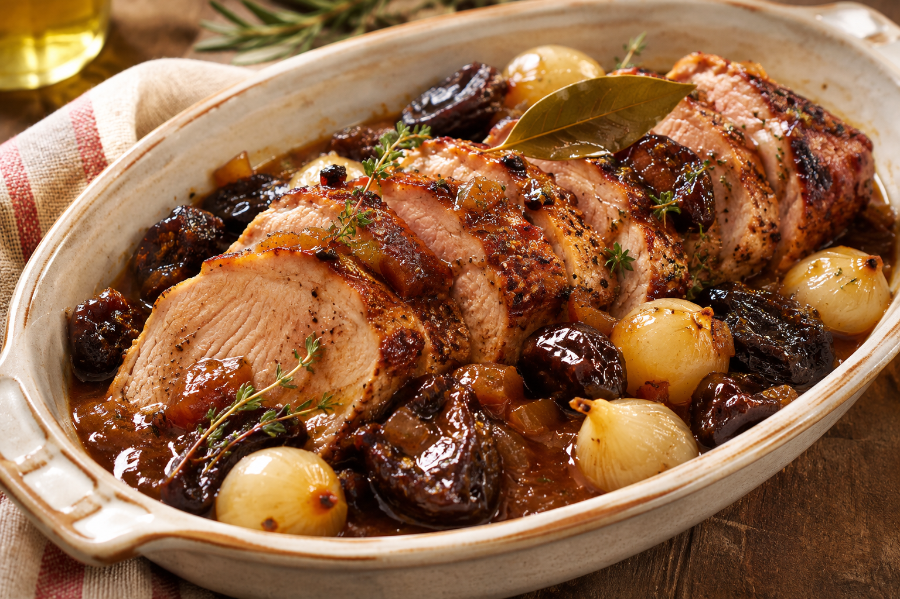

# Lomo de cerdo con ciruelas y cebollitas

**Receta:** 3 · **Chef:** Abuela Loli · **Raciones:** 4 o 6 · **Dificultad:** fácil · **Tiempo:** ~80 min

## Ingredientes

| Ingrediente | 4 personas | 6 personas |
|---|---:|---:|
| Lomo de cerdo en una pieza | 800 g | 1,2 kg |
| Cebollitas francesas | 300 g | 450 g |
| Ciruelas pasas sin hueso | 150 g | 225 g |
| Vino dulce o blanco | 150 ml | 225 ml |
| Laurel | 1 hoja | 2 hojas |
| Aceite de oliva | 2 cucharadas | 3 cucharadas |
| Agua | Hasta media altura del lomo | Hasta media altura del lomo |
| Sal y pimienta | Al gusto | Al gusto |

Las cantidades y los tiempos son orientativos: no aparecen en la receta manuscrita. Se proponen ciruelas pasas sin hueso.

## Elaboración

1. Pelar las cebollitas. Secar el lomo y salpimentarlo. Calentar el aceite en una cazuela y sellar la pieza por todos sus lados hasta que se dore.
2. Añadir las cebollitas y el laurel. Verter agua hasta media altura del lomo, sin cubrirlo del todo, y llevar a ebullición suave.
3. Tapar y cocinar a fuego bajo ~40–60 minutos, dando la vuelta al lomo a mitad de cocción. Vigilar el líquido y añadir un poco de agua si fuera necesario. El tiempo depende del grosor de la pieza.
4. Cuando la carne esté tierna, añadir las ciruelas y el vino dulce o blanco. Cocinar destapado ~10 minutos para reducir un poco la salsa. Comprobar el punto de sal.
5. Comprobar con un termómetro que el centro del lomo haya alcanzado al menos 63 °C. Retirar la carne y dejarla reposar al menos 3 minutos antes de cortarla. Servir con las cebollitas, las ciruelas y la salsa; retirar el laurel.

## Consejos

- Las cantidades, el vino y el tiempo pueden ajustarse al gusto y al tamaño de la pieza. El vino dulce da una salsa más dulce; el blanco, una menos dulce.
- El mínimo de 63 °C y 3 minutos de reposo corresponde a piezas enteras de cerdo.
