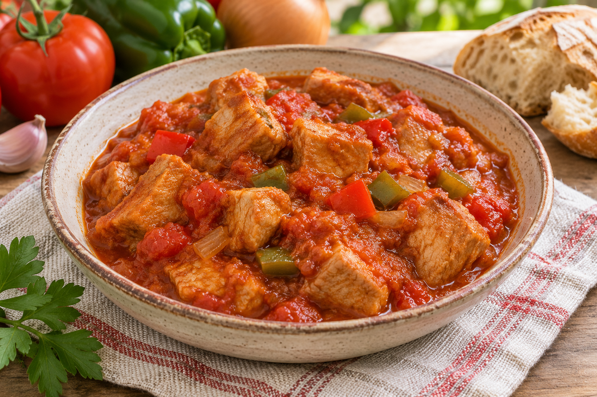

# Magro con tomate

**Chef:** Patri  
**Categoría:** Carnes  
**Raciones:** ~3  
**Dificultad:** Fácil  
**Tiempo:** ~75-90 min.

## Ingredientes

| Ingrediente | Cantidad |
|---|---:|
| Magro de cerdo en trozos | 500 g |
| Pimiento rojo | 1/2 ud. |
| Pimiento verde | 1/2 ud. |
| Cebolla | 1 ud. |
| Ajo | 2 dientes |
| Vino blanco | 1/2 vaso |
| Tomate triturado | 1 lata pequeña |
| Pimentón | al gusto |
| Romero, tomillo y laurel | al gusto |
| Aceite de oliva y sal | al gusto |

## Preparación

1. Corta la cebolla, los pimientos y los ajos en trocitos.
2. Pon aceite en una cazuela, añade la carne con sal y dórala a fuego medio durante 15 minutos.
3. Cuando la carne esté dorada, incorpora la verdura y cocina a fuego lento o medio hasta que esté tierna y la cebolla transparente.
4. Añade el pimentón, el tomillo, el romero y el laurel. Remueve brevemente para evitar que se queme el pimentón.
5. Vierte el vino blanco y deja cocer durante 15-20 minutos.
6. Cuando aún quede un poco de caldo, añade el tomate triturado y cocina 20 minutos a fuego medio. Comprueba que la carne esté tierna y cocínala algo más si lo necesita. Rectifica de sal al gusto.

## Consejos

- Las raciones y el tiempo total son orientativos. La duración puede variar según el tamaño y el corte de la carne.
- La receta lleva vino: la cocción no garantiza la eliminación completa del alcohol.
