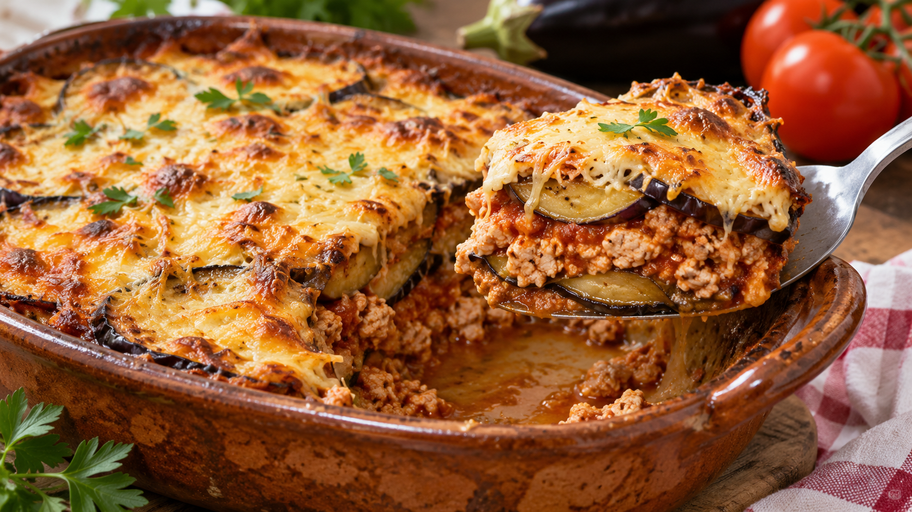

# Pastel de carne y berenjena gratinado

**Chef:** Patri  
**Categoría:** Carnes  
**Raciones:** 3  
**Dificultad:** Fácil  
**Tiempo:** ~45-60 min, incluido el gratinado.

## Ingredientes

| Ingrediente | Cantidad |
|---|---:|
| Carne picada de pavo o pollo | 500 g |
| Tomate triturado | ~400 g |
| Berenjena | 1/2 ud. |
| Cebolla | al gusto |
| Queso rallado para fundir | al gusto |
| Comino, orégano y sal | al gusto |
| Aceite de oliva | el necesario |

## Preparación

1. Pica la cebolla y rehógala con un poco de aceite a fuego medio hasta que esté pochada, ~8-10 minutos.
2. Añade la carne picada, desmenúzala y rehógala hasta que esté bien cocinada, ~7-10 minutos. Sazona y añade comino y orégano al gusto.
3. Incorpora el tomate triturado y cocina a fuego lento ~10-15 minutos, removiendo de vez en cuando.
4. Mientras tanto, corta la berenjena en rodajas y cocínalas a la plancha con un poco de aceite hasta que estén tiernas, ~3-4 minutos por cada lado.
5. En una fuente apta para horno, coloca una capa de berenjena, extiende encima la mezcla de carne y tomate y cubre con otra capa de berenjena. Espolvorea queso rallado al gusto.
6. Gratina en el horno precalentado a 200 °C durante ~10-15 minutos, hasta que el queso se funda y se dore. Sirve caliente.

## Consejos

- La cantidad de tomate es orientativa: ~400 g corresponden a la lata pequeña indicada.
- Los tiempos son orientativos y pueden variar según el grosor de las rodajas y el horno. Cocina completamente la carne antes de montar el pastel.
