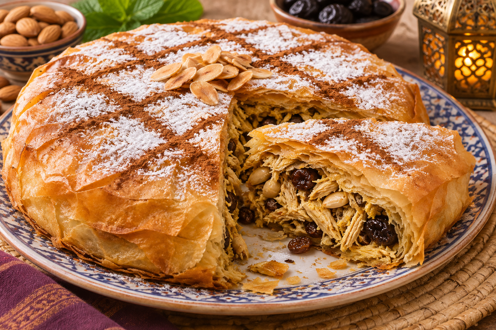

# Pastela marroquí

**Receta:** 31 · **Chef:** Abuela Loli · **Raciones:** ~6 · **Dificultad:** media · **Tiempo:** ~90 min

## Ingredientes

| Ingrediente | ~6 raciones |
|---|---:|
| Pasta filo | 6–8 hojas |
| Pollo | 600 g |
| Cebolla | 1 grande |
| Tomate triturado | 150 g |
| Pasas de Corinto | 50 g |
| Ciruelas pasas sin hueso | 80 g |
| Almendras | 60 g |
| Especias morunas | 1 cucharadita |
| Laurel | 1 hoja |
| Aceite de oliva | Para cocinar y pincelar |
| Agua | Para cubrir |
| Sal y pimienta | Al gusto |
| Canela y azúcar glas | Para espolvorear |

## Elaboración

1. Pica la cebolla. En una cazuela con aceite, póchala a fuego medio. Añade el pollo y dóralo por todos sus lados.
2. Cubre con agua y añade el tomate, las pasas, las ciruelas troceadas, la sal, la pimienta, el laurel y las especias morunas. Cocina a fuego suave hasta que el pollo esté hecho y la salsa espese, ~30–40 minutos.
3. Retira el pollo, comprueba que esté bien cocinado y desmenúzalo; retira huesos y piel si los hubiera. Retira el laurel y mezcla el pollo con la salsa reducida. Deja templar el relleno.
4. Tuesta ligeramente las almendras en una sartén, déjalas enfriar y pícalas. Precalienta el horno a 180 °C.
5. Forra un molde con varias hojas de pasta filo, pincelando cada una ligeramente con aceite y dejando parte de las hojas sobresaliendo para poder cerrar.
6. Reparte el relleno y las almendras. Dobla la masa sobre el relleno y cubre con las hojas restantes, también pinceladas con aceite.
7. Hornea a 180 °C durante ~20–30 minutos, hasta que la pasta esté dorada y crujiente. Deja templar unos minutos y espolvorea con azúcar glas y canela.

## Consejos

- Las cantidades, las raciones y los tiempos son orientativos.
- La incorporación de las almendras y el horneado completan la nota original.
- Contiene frutos de cáscara y normalmente gluten; consulta el envase de la pasta filo.
