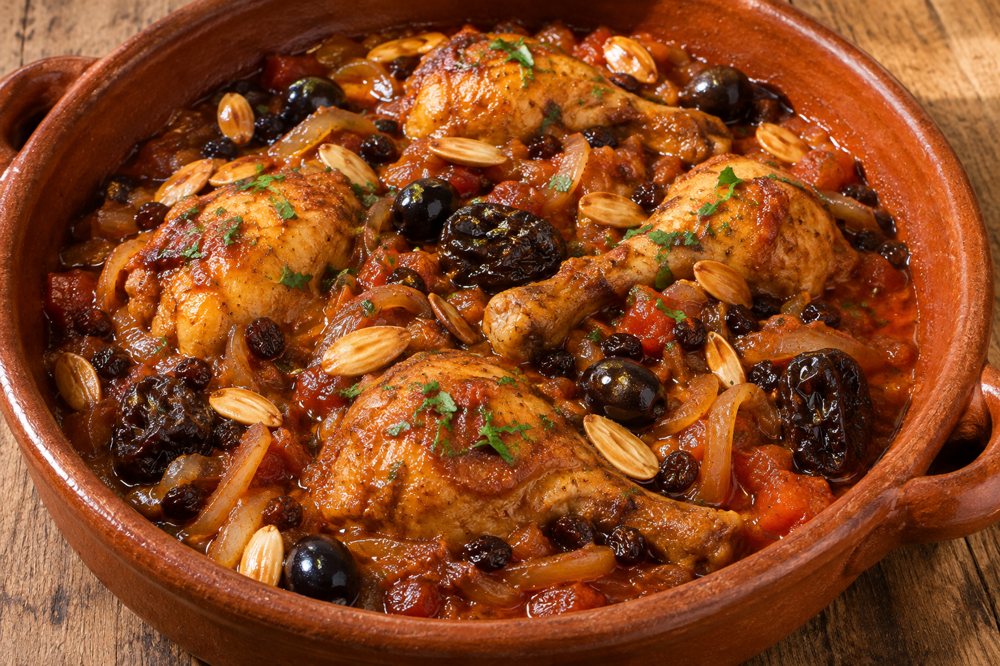

# Pollo a la moruna

**Receta:** 35 · **Chef:** Abuela Loli · **Raciones:** 4 · **Dificultad:** fácil · **Tiempo:** ~70 min

## Ingredientes

| Ingrediente | 4 raciones |
|---|---:|
| Pollo troceado | 1 kg |
| Cebolla | 1 grande |
| Tomates pelados | 2 unidades |
| Especias morunas | 1–2 cucharaditas |
| Ciruelas pasas | 80 g |
| Pasas de Corinto | 40 g |
| Aceitunas negras | 80 g |
| Almendras fritas | 50 g |
| Canela o miel | Al gusto |
| Aceite de oliva | Para freír |

## Elaboración

1. Pela y pica la cebolla. Pela y trocea los tomates. Si las ciruelas tienen hueso, retíralo.
2. Calienta aceite en una cazuela y fríe los trozos de pollo hasta que estén dorados por todos sus lados.
3. Añade la cebolla, el tomate y las especias morunas. Cocina a fuego lento, removiendo de vez en cuando; si se queda sin líquido, añade un poco de agua.
4. Cuando el pollo esté tierno y bien cocinado, incorpora las pasas y las ciruelas. Añade canela o miel al gusto y deja cocer unos minutos más.
5. Al final, añade las almendras fritas y las aceitunas negras. Mezcla suavemente y sirve caliente.

## Consejos

- Las cantidades y los tiempos son orientativos.
- Comprueba que el pollo esté bien cocinado antes de servir.
- Contiene almendras; revisa los ingredientes de la mezcla de especias.
