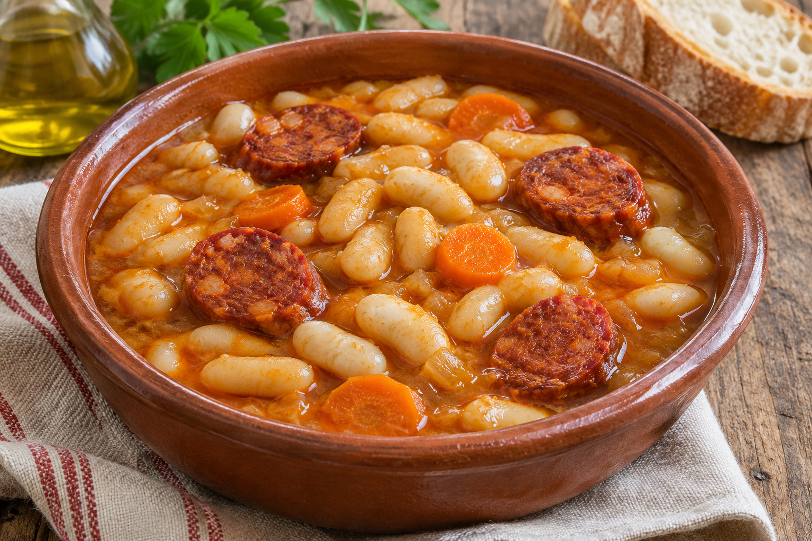

# Fabada

**Chef:** Abuela Loli  
**Categoría:** Legumbres  
**Raciones:** ~5  
**Dificultad:** Fácil  
**Tiempo:** ~2-3 h de cocción, más 1 día de remojo y ~15 min de preparación.

## Ingredientes

| Ingrediente | Cantidad |
|---|---:|
| Habichuelas secas | 500 g |
| Cebolla | 1 ud. |
| Zanahoria | al gusto |
| Ajo | al gusto |
| Chorizo | ~150 g |
| Pimentón dulce | al gusto |
| Comino y pimienta | al gusto |
| Azafrán y sal | al gusto |
| Agua | para cubrir |
| Aceite de oliva | para freír el ajo |

## Preparación

1. Remoja las habichuelas en abundante agua durante 1 día, en la nevera. Escúrrelas antes de cocinarlas.
2. Pela y corta la zanahoria en rodajas. Fríe el ajo en un poco de aceite.
3. Pon en una olla las habichuelas, la cebolla, la zanahoria y el ajo frito. Cubre con agua y añade pimienta, comino, azafrán, pimentón dulce y sal al gusto.
4. Lleva a ebullición y cocina suavemente en olla normal hasta que las habichuelas estén tiernas, ~2-3 horas. Añade agua si se necesita para mantenerlas cubiertas.
5. Incorpora el chorizo al final de la cocción y deja que se caliente bien; si es fresco, cocínalo completamente antes de servir. Ajusta el tiempo según el tipo y tamaño.

## Consejos

- La cantidad de chorizo, las raciones y el tiempo de cocción son orientativos. El tiempo varía según las habichuelas.
- Comprueba que las habichuelas estén bien cocidas y tiernas antes de servir.
