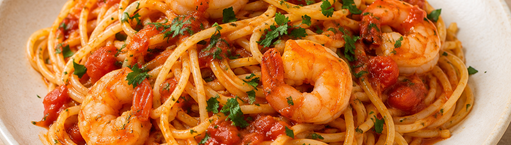

# Espaguetis a la marinera

**Receta:** 10 · **Chef:** Javi · **Raciones:** 4 · **Dificultad:** media · **Tiempo:** ~45 min

## Ingredientes

| Ingrediente | 4 raciones |
|---|---:|
| Espaguetis | 500 g |
| Mejillones | 500 g |
| Langostinos o gambas | 200 g |
| Tomates pelados en su jugo | 400 g (2 latas) |
| Cebolla | 1 |
| Ajo | 4 dientes |
| Guindillas | 2 |
| Aceite de oliva | 100 ml |
| Vino blanco | 200 ml |
| Perejil | Al gusto |
| Orégano | Al gusto |
| Sal y pimienta | Al gusto |

## Elaboración

1. Limpiar los mejillones, retirar las barbas y desechar los que estén rotos o abiertos y no se cierren al tocarlos. Reservarlos escurridos.
2. Picar la cebolla y los ajos. Calentar el aceite en una sartén amplia o cazuela y dorarlos a fuego medio, sin que se quemen.
3. Añadir los mejillones y el vino blanco. Llevar a ebullición y, cuando empiece a hervir, incorporar el perejil picado, los tomates con su jugo, las guindillas picadas, el orégano y un poco de sal y pimienta.
4. Cocinar a fuego vivo, removiendo de vez en cuando, hasta que los mejillones se abran y la salsa reduzca. Desechar los mejillones que permanezcan cerrados tras la cocción.
5. Incorporar los langostinos o gambas y cocinar solo unos minutos, hasta que estén rosados y hechos.
6. Cocer los espaguetis en agua con sal siguiendo el tiempo indicado en el paquete. Escurrirlos, mezclarlos con la salsa y servir con perejil picado.

## Consejos

- Prueba la salsa antes de añadir más sal: el marisco y la reducción pueden intensificar su sabor.
- Los ~45 minutos son orientativos; incluyen la limpieza del marisco, la cocción de la salsa y la pasta.
