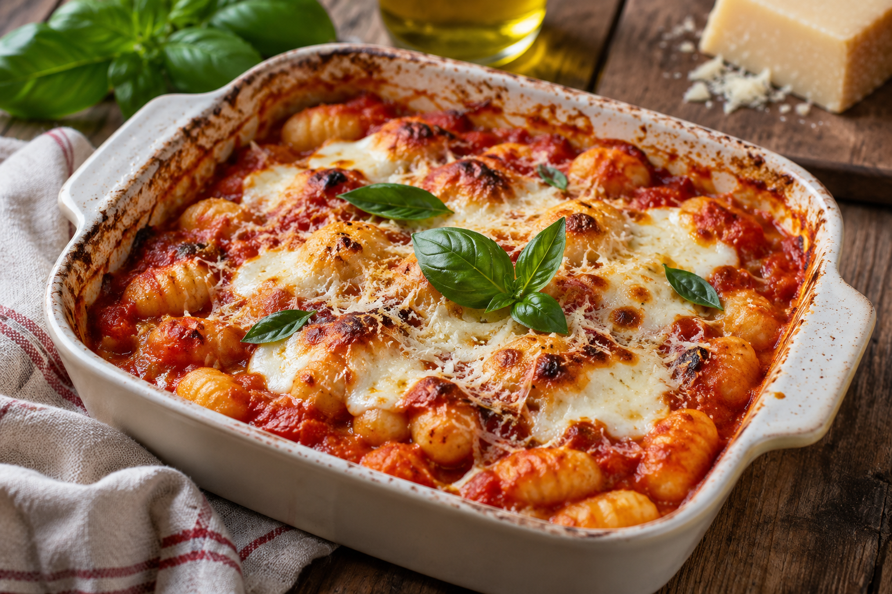

# Gnocchi alla sorrentina

**Receta:** 4 · **Chef:** Javi · **Raciones:** 3–4 · **Dificultad:** fácil · **Tiempo:** ~35 min

## Ingredientes

| Ingrediente | 3–4 personas |
|---|---:|
| Gnocchi | 500 g |
| Cebolleta | 1 unidad |
| Ajo | ½ diente |
| Tomate entero en lata, con su jugo | 400 g |
| Mozzarella fresca | 125 g |
| Queso parmesano | 3 cucharadas |
| Albahaca | Al gusto |
| Aceite de oliva | El necesario |
| Sal y pimienta | Al gusto |

## Elaboración

1. Hervir los gnocchi en agua hasta que suban a la superficie. Escurrirlos y reservarlos.
2. Precalentar el horno a 200 °C. Picar la cebolleta y el ajo. Cortar la mozzarella en cubos.
3. Pochar la cebolleta y el ajo con aceite y una pizca de sal. Añadir el tomate con su jugo y trocearlo en la sartén.
4. Añadir pimienta, albahaca y sal al gusto. Dejar que la salsa reduzca durante 10 minutos.
5. Incorporar los gnocchi y la mitad de la mozzarella a la salsa. Mezclar y repartir en una fuente apta para horno.
6. Cubrir con el parmesano y repartir por encima el resto de la mozzarella. Añadir pimienta y gratinar de 5 a 10 minutos en el horno, hasta que el queso se dore. Servir caliente.

## Consejos

- Los ~35 minutos totales son orientativos y pueden variar según el horno y el tiempo que tarde en calentarse el agua.
- Vigilar el gratinado durante los últimos minutos para que el queso no se queme.
