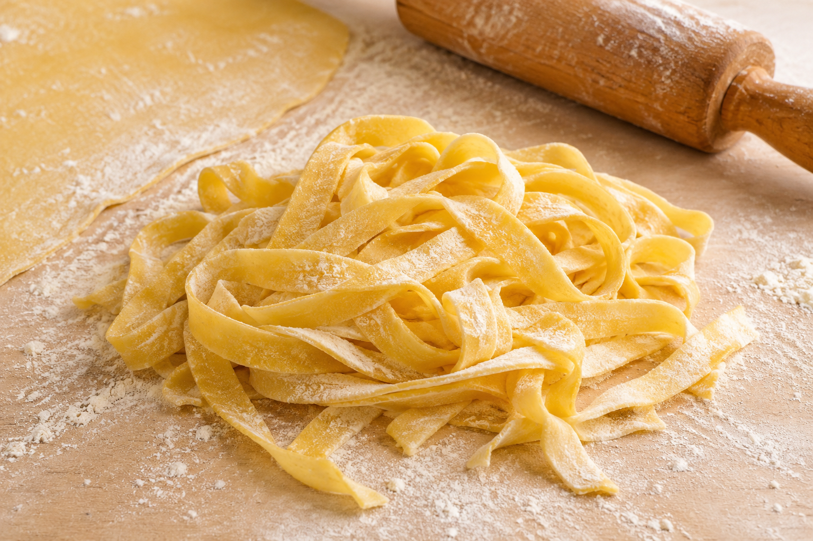

# Masa de pasta fresca

**Receta:** 5 · **Chef:** Thermomix · **Raciones:** ~6 · **Dificultad:** media · **Tiempo activo:** ~30 min · **Reposo:** 15 min–3 h

## Ingredientes

| Ingrediente | ~6 raciones |
|---|---:|
| Harina de trigo | 600 g |
| Huevos | 6 unidades |
| Sal | 1 cucharadita |
| Aceite de oliva | 2 cucharadas |
| Harina adicional para estirar y secar | La necesaria |

El número de raciones es orientativo; la nota original no lo indica.

## Elaboración

1. Poner la harina, los huevos, la sal y el aceite de oliva en el vaso de la Thermomix. Mezclar durante 1 minuto a velocidad 3–4.
2. Amasar durante 10 minutos en velocidad espiga. Sacar la masa y amasarla a mano unos minutos hasta que esté uniforme.
3. Tapar la masa y dejarla reposar entre 15 minutos y 3 horas; si se prolonga el reposo, conservarla en el frigorífico.
4. Estirar la masa y cortarla con la máquina de pasta. Enharinarla y dejarla secar brevemente, separando las piezas para que no se peguen.
5. Cocer la pasta durante 2 minutos en abundante agua salada hirviendo. Comprobar el punto, ya que puede variar según el grosor, escurrir y servir.

## Consejos

- Mantener cubierta la masa durante el reposo para que no se reseque.
- El tiempo activo y las raciones son orientativos. El reposo y el secado se suman al tiempo total.
