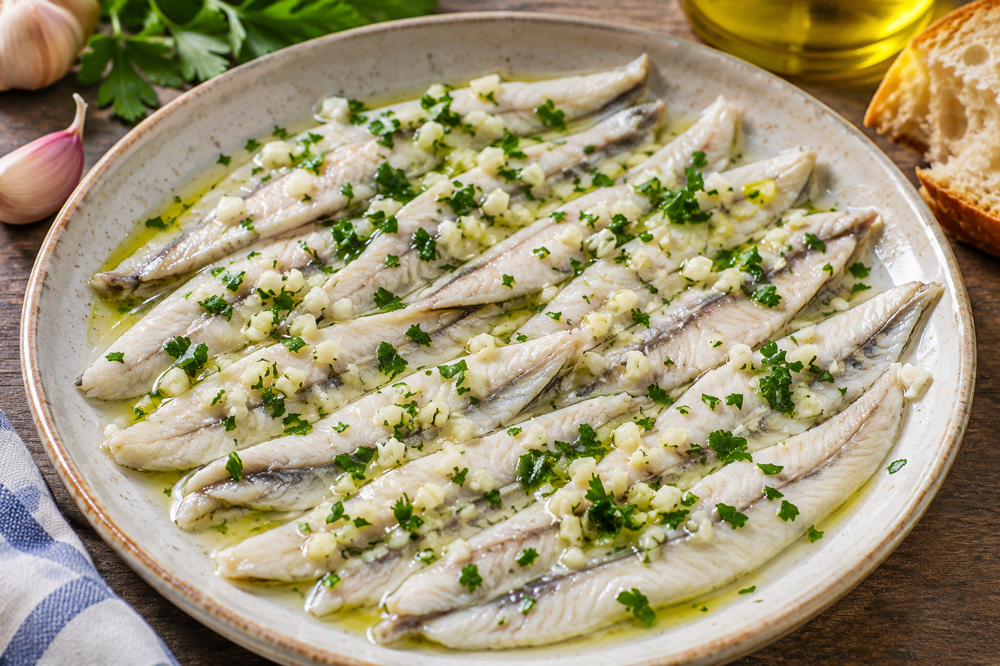

# Boquerones en vinagre

**Chef:** Ela  
**Categoría:** Pescados  
**Raciones:** 4 de aperitivo  
**Dificultad:** Fácil  
**Tiempo:** ~25 min de preparación + 24 h de marinado, además de 5 días de congelación y el tiempo de descongelación.

Las cantidades son orientativas; la receta original no las especifica.

## Ingredientes

| Ingrediente | 4 raciones |
|---|---:|
| Boquerones limpios y abiertos | 500 g |
| Agua | 80 ml, menos de medio vaso |
| Vinagre | El necesario para cubrir |
| Ajo | 3 dientes |
| Perejil fresco | Al gusto |
| Sal | Al gusto |

## Preparación

1. Limpia los boquerones, retira las cabezas, las tripas y las espinas, y ábrelos en lomos. Congélalos al menos 5 días a -20 °C o menos. Si tu congelador no alcanza esa temperatura, compra pescado ya congelado adecuado para consumo en crudo.
2. Descongélalos en la nevera, en un recipiente que recoja los líquidos. Colócalos en un recipiente apto para alimentos y añade sal al gusto.
3. Añade menos de medio vaso de agua y vinagre suficiente para cubrirlos. Machaca dos dientes de ajo e incorpóralos al recipiente.
4. Tapa y deja marinar en la nevera durante 24 horas.
5. Ve sacando las porciones que vayas a comer y sírvelas con el diente de ajo restante picado y perejil picado por encima.

## Consejos

- Mantén los boquerones refrigerados durante la descongelación, el marinado y la conservación; utiliza utensilios limpios y consume cuanto antes.
- El vinagre no elimina de forma fiable el anisakis ni todos los riesgos microbiológicos. La congelación indicada reduce el riesgo de anisakis, pero no sustituye una manipulación higiénica.
- La cantidad de vinagre depende del recipiente: utiliza uno ajustado para cubrir los boquerones sin añadir agua de más.
