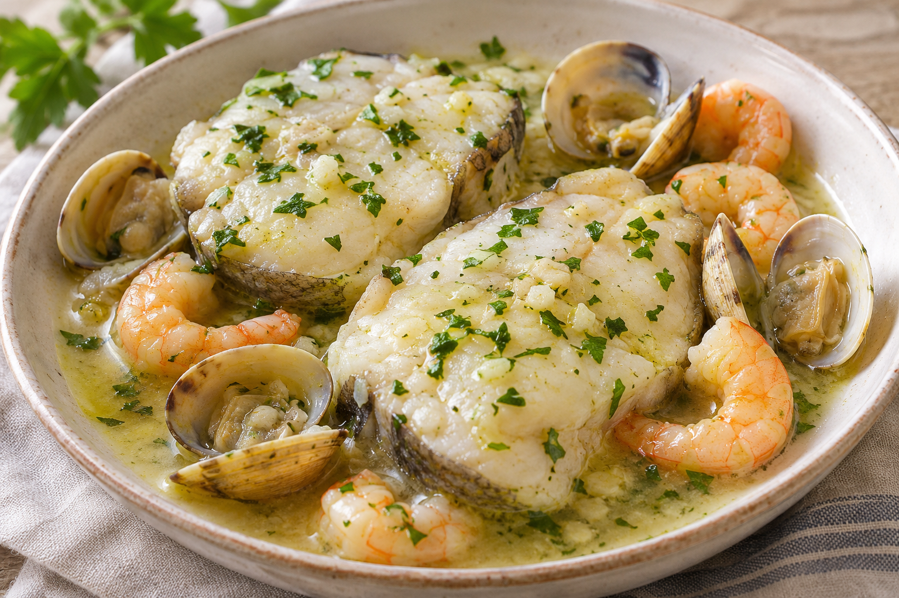

# Merluza en salsa

**Chef:** Ela  
**Raciones:** 4 orientativas  
**Dificultad:** Fácil  
**Tiempo:** ~35 min

## Ingredientes

- 1 merluza en rodajas, limpia
- 250 g de gambas
- 250 g de almejas
- 2-3 dientes de ajo
- 1 cucharada de harina
- ~300 ml de caldo de pescado o de caldo preparado con las cabezas de las gambas; alternativamente, agua con una pastilla de caldo de pescado
- Aceite de oliva, al gusto
- Sal y perejil, al gusto

## Elaboración

1. Pela las gambas y reserva las cabezas si vas a preparar el caldo con ellas. Lava las almejas y mantenlas en agua fría con sal para que suelten la arena; enjuágalas después.
2. Calienta un poco de aceite en una sartén amplia y añade los 2-3 ajos enteros. Antes de que se doren, incorpora la harina y remueve brevemente.
3. Añade poco a poco el caldo de pescado o el caldo de las cabezas de las gambas y remueve hasta obtener una salsa ligada. Si usas pastilla, disuélvela en agua caliente y añádela poco a poco.
4. Incorpora las rodajas de merluza, las gambas peladas y las almejas. Cocina a fuego lento hasta que la merluza esté completamente hecha, las gambas opacas y las almejas abiertas; el tiempo dependerá del grosor del pescado.
5. Ajusta de sal, espolvorea perejil y sirve caliente. Desecha las almejas que no se hayan abierto tras la cocción.

## Consejos

- Las raciones, el tiempo y la cantidad de caldo son orientativos; ajusta el caldo para conseguir la textura deseada.
- Para preparar el caldo, cuece las cabezas de las gambas en agua, aplástalas suavemente y cuela el líquido antes de utilizarlo.
- Si utilizas pastilla de caldo, prueba la salsa antes de añadir sal.
