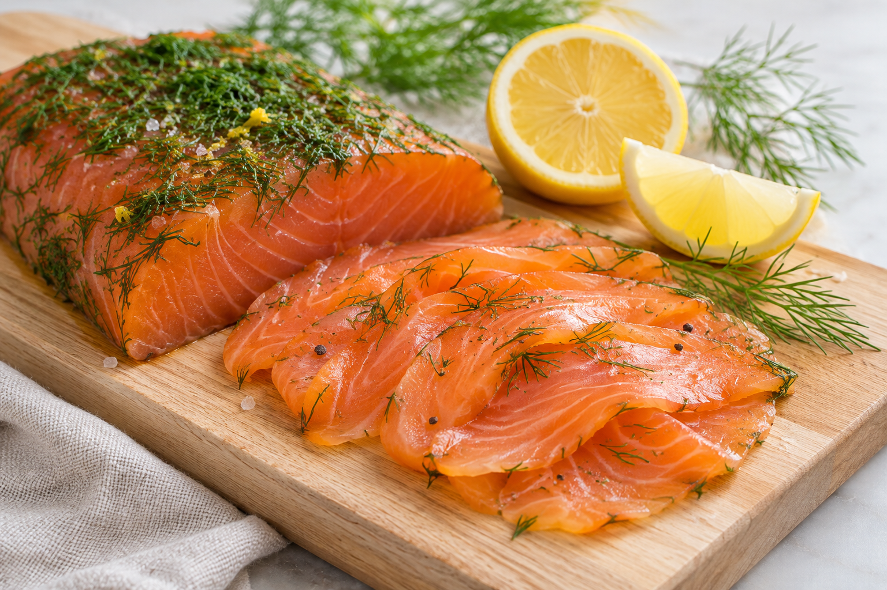

# Salmón marinado

**Chef:** Patri  
**Raciones:** 4  
**Dificultad:** Fácil  
**Tiempo:** ~30 min de preparación + 24 h de marinado, además de la congelación y descongelación previas.

Las cantidades son orientativas: la receta original no las especifica.

## Ingredientes

### Salmón marinado

- 600 g de lomo de salmón sin espinas
- 150 g de sal gruesa
- 150 g de azúcar
- 1 cucharada de coñac
- 2 cucharadas de eneldo picado
- 1 cucharadita de pimienta roja en grano
- Piel de 1 limón o 1 naranja, sin la parte blanca

### Vinagreta

- 3 cucharadas de aceite de oliva virgen extra
- 1 cucharada de vinagre
- 1 cucharada de eneldo picado
- Sal y pimienta al gusto

### Acompañamiento

- 240 g de arroz en crudo
- 2 tomates
- 1 cebolla pequeña
- Cebollino al gusto

## Elaboración

1. Congela el salmón durante al menos 5 días a -20 °C o menos en un congelador de al menos tres estrellas. Descongélalo en la nevera, en un recipiente que recoja los líquidos.
2. Mezcla la sal, el azúcar, el coñac, el eneldo, la pimienta roja y la piel de cítrico. Extiende parte de la mezcla en un recipiente, coloca el salmón encima y cúbrelo con el resto. Tapa y deja en la nevera 24 horas.
3. Retira la mezcla, enjuaga brevemente el salmón con agua fría y sécalo con papel de cocina limpio. Córtalo en láminas finas.
4. Cuece el arroz según las indicaciones del envase. Escúrrelo y, si se sirve frío, enfríalo rápidamente y consérvalo en la nevera hasta el momento de montar el plato.
5. Corta los tomates y la cebolla en dados pequeños y pica el cebollino.
6. Mezcla el vinagre, una pizca de sal, pimienta y eneldo. Añade el aceite y bate hasta integrar.
7. Sirve el arroz con el tomate, la cebolla y el cebollino. Coloca encima el salmón y aliña con la vinagreta.

## Consejos

- El marinado no elimina de forma fiable el anisakis ni otros riesgos microbiológicos. Mantén el pescado siempre refrigerado y usa utensilios limpios.
- Si tu congelador no alcanza -20 °C, compra pescado ya congelado adecuado para consumo en crudo y consulta al proveedor.
- Consume el salmón cuanto antes tras el marinado; los 4-5 días indicados en la nota original no constituyen una vida útil validada para esta preparación casera.
- El coñac no se cocina y puede dejar alcohol residual.
