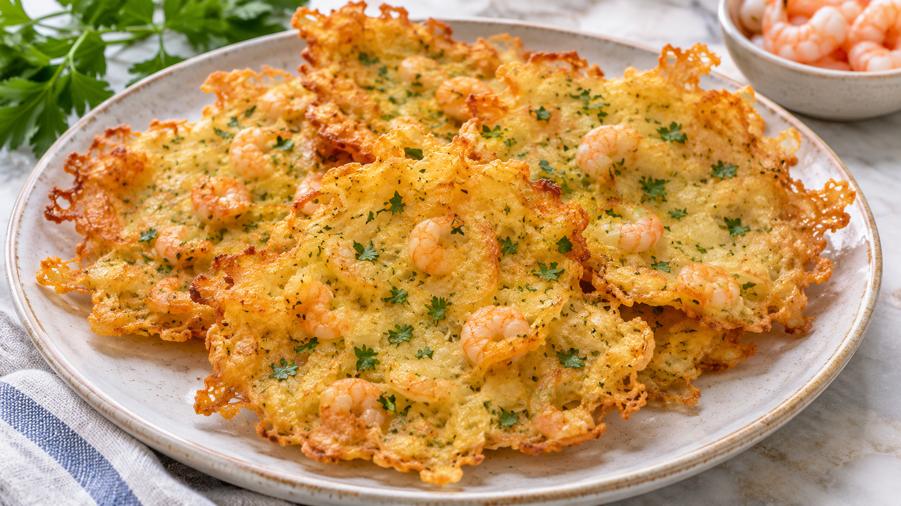

# Tortillita de gambas

**Chef:** Abuela Loli  
**Categoría:** Pescados  
**Raciones:** ~4 de aperitivo  
**Dificultad:** Fácil  
**Tiempo:** ~30 min.

## Ingredientes

| Ingrediente | Cantidad |
|---|---:|
| Gambas peladas crudas | ~250 g |
| Harina de trigo | ~150 g |
| Huevo | 1 ud. |
| Agua templada | 1 vaso (~200 ml) |
| Ajo | ~1 diente |
| Levadura química | ~1 cdta. |
| Perejil fresco | al gusto |
| Azafrán | unas hebras |
| Sal | una pizca |
| Aceite de oliva | para freír |

## Preparación

1. Pica el ajo y el perejil. Si las gambas son grandes, córtalas en trozos pequeños.
2. Bate el huevo en un bol y añade el agua templada, el ajo, el perejil, las gambas, una pizca de sal y el azafrán. Mezcla bien.
3. Mezcla la levadura química con la harina e incorpórala poco a poco a la masa, removiendo hasta obtener una mezcla homogénea, fluida pero con cuerpo. Ajusta la harina si es necesario.
4. Calienta abundante aceite en una sartén. Vierte pequeñas porciones de masa, extendiéndolas para formar tortillitas, y fríelas por tandas hasta que se doren por ambos lados y las gambas estén completamente cocinadas.
5. Retira las tortillitas y déjalas escurrir sobre papel de cocina. Sirve calientes.

## Consejos

- Las cantidades indicadas con ~ y las raciones son orientativas. Ajusta la harina para conseguir la textura de la masa.
- También puedes prepararlas con bacalao en lugar de gambas; si está salado, desálalo antes y ajusta la sal.
