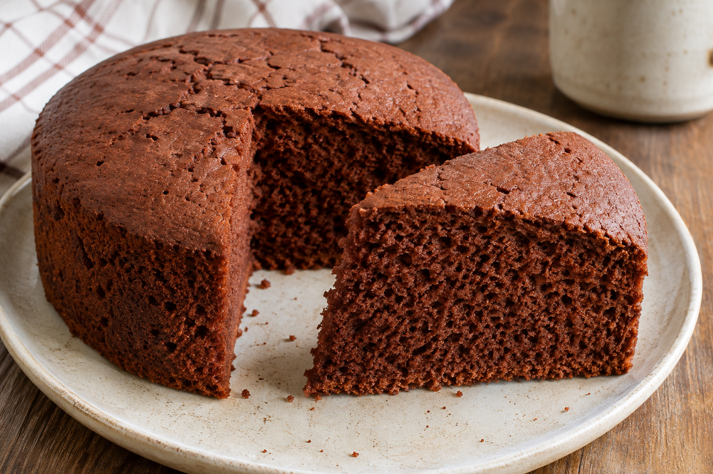

# Bizcocho de chocolate

**Chef:** Patri  
**Raciones:** ~8  
**Dificultad:** Fácil  
**Tiempo:** ~10 min de preparación + 60 min de horno

## Ingredientes

Usa un vaso de 250 ml para todas las medidas. Las cantidades en mililitros indican volumen, también en los ingredientes secos.

- 4 huevos
- 1 vaso y medio de azúcar (375 ml de volumen)
- ½ vaso de aceite de girasol (125 ml)
- ½ vaso de leche (125 ml)
- 1 vaso de Nesquik (250 ml de volumen)
- 1 vaso y medio de harina (375 ml de volumen)
- 1 sobre de levadura química de repostería

## Elaboración

1. Precalienta el horno a 180 °C y prepara un molde apto para horno, engrasándolo ligeramente o forrándolo con papel de hornear.
2. Mezcla todos los ingredientes con la batidora hasta obtener una masa homogénea. Vierte la mezcla en el molde.
3. Hornea a 180 °C durante 1 hora, como indica la receta original. Comprueba el punto pinchando el centro con un palillo: debe salir sin masa cruda. Si necesita más tiempo, continúa la cocción y vuelve a comprobar.
4. Deja templar antes de desmoldar y enfriar sobre una rejilla.

## Consejos

- Las raciones y el tiempo de preparación son orientativos. El tiempo de horno puede variar según el molde y el horno; vigila el bizcocho y comprueba el punto.
- Un vaso de 250 ml mide volumen; no equivale necesariamente a 250 g de ingredientes secos.
