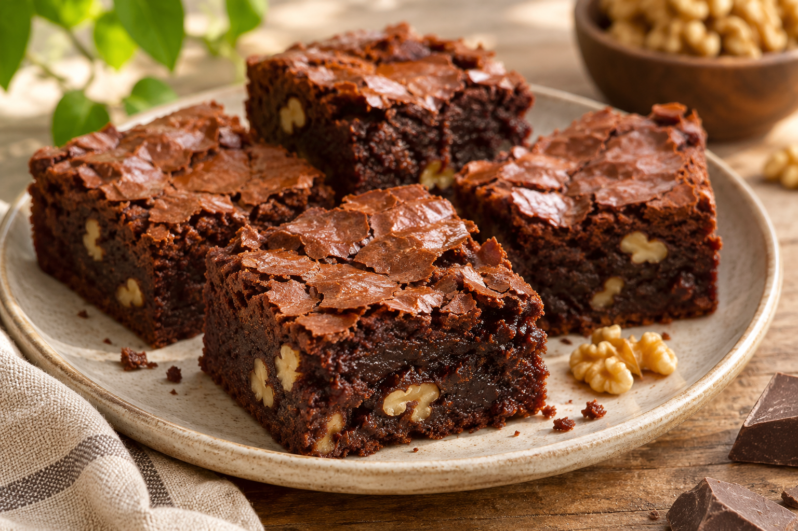

# Brownie de chocolate y nueces

**Chef:** Patri  
**Categoría:** Postres  
**Raciones:** ~6  
**Dificultad:** Fácil  
**Tiempo:** ~25 min de preparación + ~40 min de horneado y enfriado.

## Ingredientes

| Ingrediente | Cantidad |
|---|---:|
| Harina | 75 g |
| Bicarbonato | 1 cdta. |
| Sal | al gusto |
| Mantequilla | 75 g + para el molde |
| Azúcar | 150 g |
| Agua | 2 cdas. |
| Chocolate fondant | 300 g |
| Huevos L | 2 uds. |
| Nueces | 100 g |
| Vainilla o azúcar avainillado | al gusto |

## Preparación

1. Precalienta el horno a 150 °C. Mezcla en un bol la harina, el bicarbonato y la sal.
2. Pon en un cazo la mantequilla, el azúcar y el agua. Calienta a fuego lento, removiendo, hasta que empiece a hervir y retira del fuego.
3. Añade 150 g del chocolate y la vainilla o el azúcar avainillado. Remueve hasta que el chocolate se derrita por completo.
4. Incorpora los huevos de uno en uno, removiendo después de cada adición. Agrega poco a poco la mezcla de harina y mezcla bien.
5. Trocea los 150 g de chocolate restantes en trozos gruesos y pica las nueces. Incorpora ambos a la masa.
6. Engrasa un molde con mantequilla y vierte la masa. Hornea a 150 °C durante 40 minutos; comprueba el punto y ajusta el tiempo si es necesario. Deja enfriar antes de cortar.

## Consejos

- Las raciones son orientativas. El tiempo puede variar según el molde y el horno.
- El brownie debe quedar húmedo, pero la masa no debe estar líquida en el centro.
