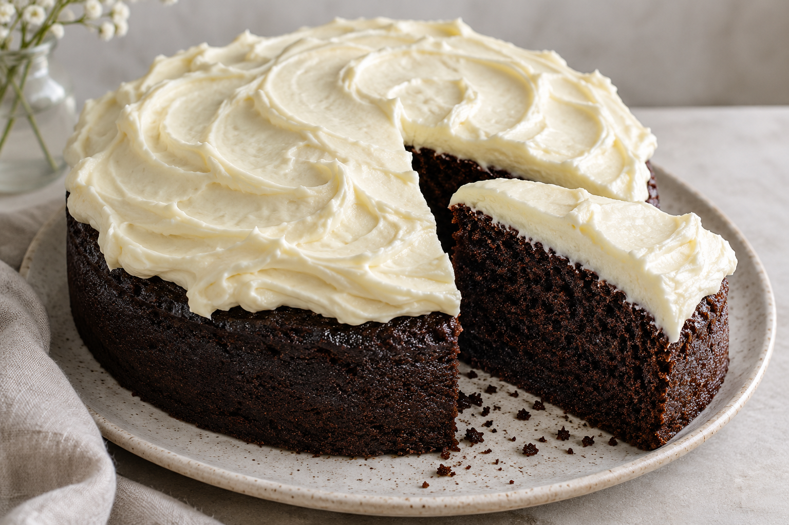

# Tarta de cerveza Guiness

**Receta:** 15 · **Chef:** Patri · **Raciones:** ~10-12 · **Dificultad:** media · **Tiempo:** ~80 min, más enfriado

Molde de 24 cm. Las raciones y el tiempo total son orientativos.

## Ingredientes

### Bizcocho

- Cerveza Guinness: 250 ml
- Mantequilla: 250 g
- Cacao en polvo: 75 g
- Bicarbonato: 2,5 cucharaditas
- Huevos: 2
- Azúcar: 400 g
- Harina: 250 g
- Azúcar avainillado: 1 cucharadita
- Nata líquida, 35 % MG: 140 ml

### Frosting

- Queso de untar: 300 g
- Nata líquida, 35 % MG: 360 ml
- Azúcar glas: 150 g

## Elaboración

1. Calienta la cerveza en un cazo. Cuando esté caliente, aparta del fuego, añade la mantequilla, remueve hasta que se funda y reserva.
2. En un bol grande, mezcla el cacao, el azúcar, la harina, el azúcar avainillado y el bicarbonato.
3. En otro bol, bate los huevos con los 140 ml de nata. Añade la mezcla de cerveza y mantequilla y remueve.
4. Incorpora los líquidos a los ingredientes secos y mezcla. Vierte en un molde de 24 cm y hornea en horno precalentado a 180 °C durante 50 minutos.
5. Saca el bizcocho del horno y deja que se enfríe por completo.
6. Para el frosting, mezcla el queso de untar con el azúcar glas. Monta por separado los 360 ml de nata e incorpóralos a la mezcla de queso. Decora el bizcocho al gusto.

## Consejos

- Comprueba la cocción con una brocheta; el tiempo puede variar según el horno.
- Conserva la tarta refrigerada por el frosting de queso y nata.
- Contiene gluten, leche y huevo. La cerveza aporta alcohol.
