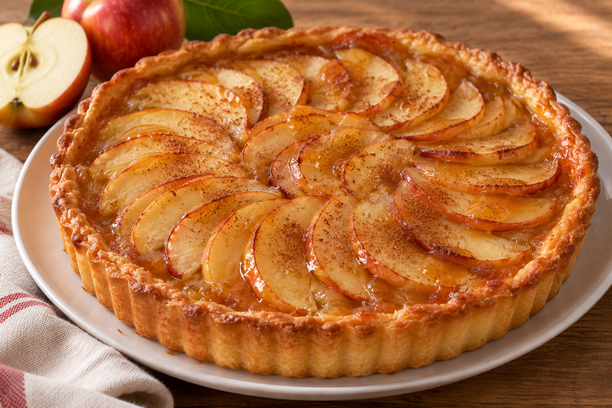

# Tarta de Manzana

**Receta:** 27 · **Chef:** Ela · **Raciones:** ~8 · **Dificultad:** media · **Tiempo:** ~90 min

## Ingredientes

| Ingrediente | ~8 raciones |
|---|---:|
| Harina de trigo | 250–300 g |
| Mantequilla derretida | 150 g |
| Huevo | 1 |
| Levadura | ½ sobre |
| Agua para la masa | 1 chupito |
| Azúcar para la masa | 3–4 cucharadas |
| Manzanas | ~5 unidades |
| Agua para el relleno | Un poco |
| Ron | 1 vaso |
| Azúcar para el relleno y acabado | Al gusto |
| Canela | Al gusto |
| Mermelada | Para pintar |

## Elaboración

1. Mezcla la harina con la mantequilla derretida. Incorpora el huevo, la levadura, el agua y el azúcar de la masa; trabaja hasta obtener una masa manejable. Añade la harina poco a poco, pues la cantidad es orientativa.
2. Extiende la masa en un molde de unos 22 cm, cubriendo la base y los laterales. Reserva mientras preparas el relleno. Precalienta el horno a 180 °C.
3. Pela y trocea la mayor parte de las manzanas; reserva una o dos para la superficie. Cocina la manzana troceada con un poco de agua a fuego lento hasta que se ablande.
4. Añade el ron y azúcar al gusto. Cocina removiendo hasta que la mezcla se dore y espese. Reparte el relleno sobre la masa.
5. Corta las manzanas reservadas en rodajas finas y colócalas sobre el relleno. Espolvorea azúcar y canela.
6. Hornea a 180 °C durante ~35–45 minutos, hasta que la masa esté cocida y dorada. Vigila el final de la cocción: el tiempo depende del horno y del grosor de la masa.
7. Diluye ligeramente la mermelada con agua y pinta la superficie de la tarta. Deja templar antes de desmoldar y servir.

## Consejos

- Las cantidades de harina y manzana, las raciones y el horneado son orientativos.
- La receta original indica un vaso de ron, sin precisar su tamaño; el alcohol puede no evaporarse por completo.
- Contiene gluten, huevo y leche.
