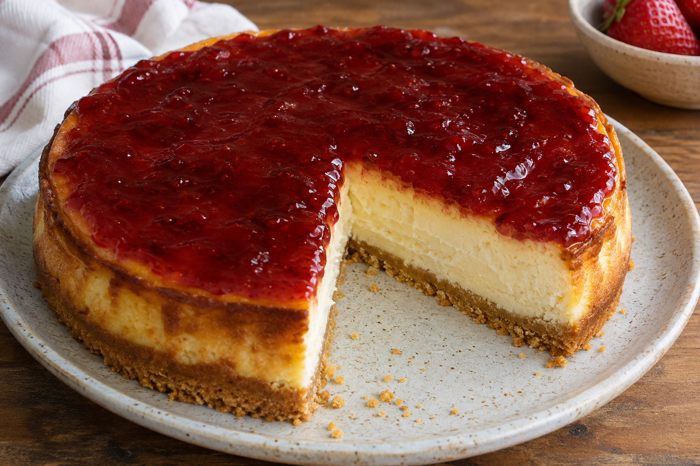

# Tarta de queso al horno

**Receta:** 22 · **Chef:** Patri · **Raciones:** ~8 · **Dificultad:** media · **Tiempo:** ~65 min, más enfriado y refrigeración

## Ingredientes

Para ~8 raciones; cantidad de canela, vino y mermelada al gusto.

- Galletas María: 1 tubo
- Mantequilla: 80 g + para el molde
- Canela molida: al gusto
- Vino blanco: un chorrito
- Huevos: 3
- Queso batido: 500 g
- Leche condensada: 400 g
- Mermelada: para cubrir

## Elaboración

1. Precalienta el horno a 180 °C con calor arriba y abajo. Tritura las galletas y ponlas en un bol.
2. Añade los 80 g de mantequilla derretida, la canela molida y un chorrito de vino blanco. Mezcla para formar la base.
3. Engrasa el molde con mantequilla. Extiende la mezcla de galletas con las manos y presiónala para formar la base.
4. Mezcla en una jarra los 3 huevos, el queso batido y la leche condensada. Vierte la mezcla sobre la base de galletas.
5. Hornea a 180 °C durante 45 minutos. Al terminar, abre la puerta del horno y deja enfriar la tarta dentro.
6. Cuando esté a temperatura ambiente, métela en la nevera. Cubre la tarta con mermelada para servir.

## Consejos

- Las raciones y el tiempo total son orientativos; los 45 minutos de horno proceden de la receta.
- Conserva la tarta refrigerada.
- Contiene leche, huevo y gluten; el vino puede contener sulfitos.
