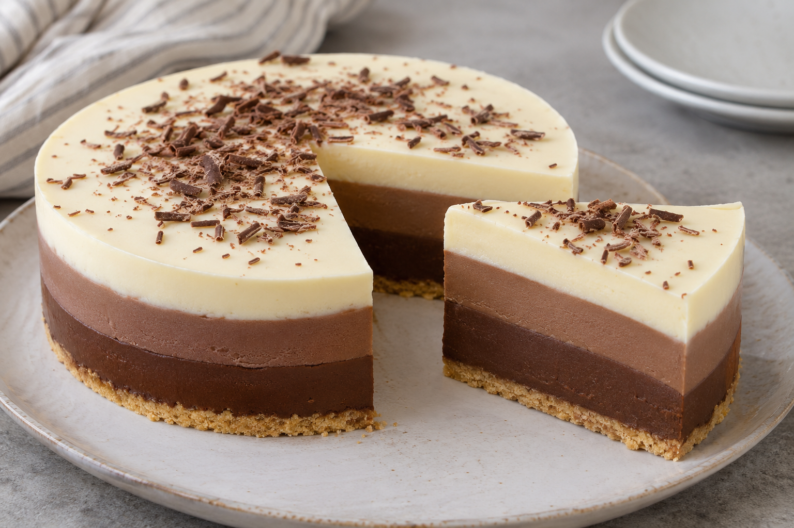

# Tarta tres chocolates

**Receta:** 29 · **Chef:** Patri · **Raciones:** ~10-12 · **Dificultad:** media · **Tiempo:** ~45 min, más refrigeración

## Ingredientes

Para ~10-12 raciones; cantidad de galletas orientativa.

- Galletas María: ~180 g
- Mantequilla: 60 g
- Chocolate negro: 150 g
- Chocolate con leche: 150 g
- Chocolate blanco: 150 g
- Nata para montar: 750 ml
- Leche: 750 ml
- Cuajada en polvo: 3 sobres
- Azúcar: 150 g
- Adorno: al gusto

## Elaboración

1. Tritura las galletas María y mézclalas con la mantequilla derretida. Si hace falta, añade un poco de leche. Extiende y presiona la mezcla en la base de un molde.
2. Para cada capa reserva 150 g de chocolate, 250 ml de nata, 250 ml de leche, un sobre de cuajada y 50 g de azúcar.
3. Para la primera capa, disuelve un sobre de cuajada en un poco de sus 250 ml de leche fría. Calienta el resto de esa leche con 250 ml de nata, 50 g de azúcar y el chocolate negro troceado, removiendo hasta fundirlo.
4. Añade la cuajada disuelta y cocina removiendo según las instrucciones del sobre. Vierte sobre la base de galletas y deja que la superficie empiece a cuajar.
5. Repite el mismo proceso con el chocolate con leche y, después, con el blanco, usando para cada uno sus cantidades reservadas. Vierte cada capa suavemente sobre el dorso de una cuchara para no romper la anterior.
6. Cuando las tres capas estén listas, deja enfriar y refrigera durante al menos 4 horas, hasta que la tarta cuaje. Desmolda y adorna al gusto.

## Consejos

- La cantidad de galletas y las raciones son orientativas. El reparto del azúcar entre capas es una propuesta.
- Para que las capas se unan, vierte la siguiente cuando la anterior haya empezado a cuajar.
- Conserva refrigerada. Contiene leche y gluten; revisa los alérgenos del chocolate y de la cuajada.
