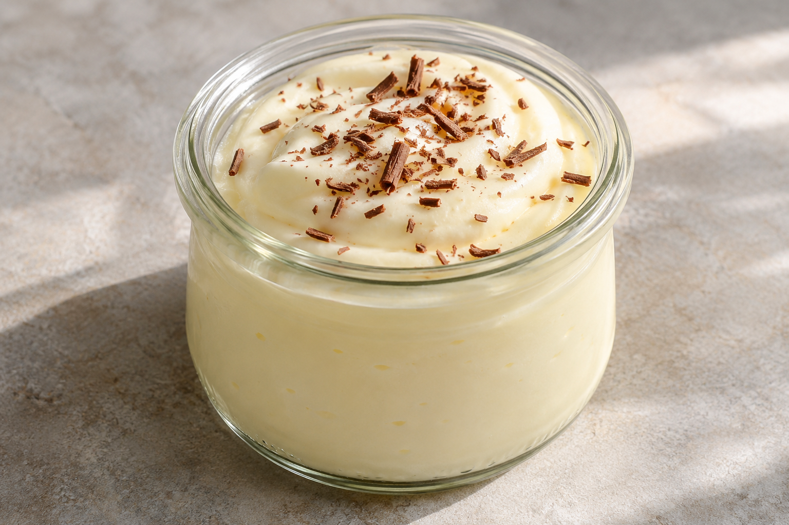

# Yogur de limón

**Receta:** 25 · **Chef:** Patri · **Raciones:** ~4-6 · **Dificultad:** media · **Tiempo:** ~10 min, más refrigeración

## Ingredientes

Las raciones dependen del tamaño de los tarritos.

- Yogures griegos sin azúcar: 2
- Leche condensada: 1 lata pequeña
- Nata líquida para montar: 200 ml
- Limón: 1, su zumo
- Virutas de chocolate: al gusto

## Elaboración

1. Exprime el limón y retira las semillas del zumo.
2. Mezcla en un bol los yogures, la leche condensada, la nata líquida sin montar y el zumo de limón hasta obtener una crema homogénea.
3. Reparte la mezcla en tarritos y guárdalos en la nevera hasta que esté fría.
4. Decora con virutas de chocolate antes de servir.

## Consejos

- Las raciones y el tiempo de preparación son orientativos.
- Conserva los tarritos tapados y refrigerados.
- Contiene leche; comprueba los alérgenos de las virutas de chocolate.
