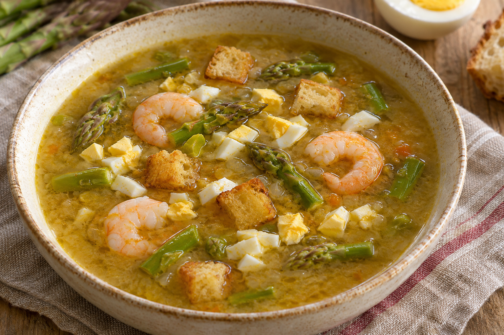

# Sopa de espárragos

**Receta:** 36 · **Chef:** Abuela Loli · **Raciones:** 6 · **Dificultad:** media · **Tiempo:** ~60 min

## Ingredientes

Para 6 personas; cantidades orientativas.

- Espárragos: ~600 g
- Gambas peladas: ~300 g
- Huevos: ~3
- Cebolleta: ~1
- Pimiento rojo: ~1
- Zanahoria: ~1
- Tomates: ~2
- Ajo: ~2 dientes
- Agua: ~2 l
- Laurel: ~1 hoja
- Tomillo, comino y orégano: al gusto
- Azafrán (opcional): ~1 pizca
- Pan: ~100 g
- Aceite de oliva: el necesario
- Sal: al gusto

## Elaboración

1. Si los espárragos son frescos, límpialos, trocéalos y cuécelos previamente en agua hasta que estén tiernos; conserva el agua de cocción. Si son congelados, no necesitan esta cocción previa.
2. Trocea la cebolleta, el pimiento rojo, la zanahoria, los tomates y los ajos. Sofríelos en aceite hasta que estén tiernos y tritura el refrito.
3. Añade el refrito triturado a la cazuela con el agua y los espárragos. Incorpora sal, laurel, tomillo, comino, orégano y, si lo deseas, azafrán. Añade las gambas peladas.
4. Cuece el conjunto aproximadamente 20 minutos, hasta que los espárragos estén tiernos y las gambas bien cocinadas. Ajusta la sal.
5. Mientras, cuece los huevos, enfríalos, pélalos y pícalos. Corta el pan en dados y fríelo en aceite hasta dorarlo; escúrrelo.
6. Sirve la sopa con el huevo duro picado y el pan frito.

## Consejos

- Las cantidades y el tiempo total son orientativos.
- Si usas espárragos congelados, añádelos directamente a la cazuela sin cocción previa.
- Contiene crustáceos, huevo y gluten.
