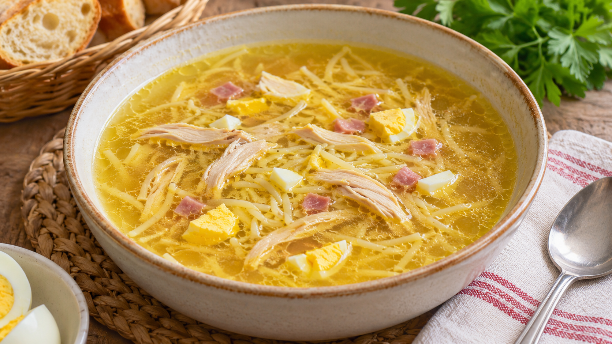

# Sopa de picadillo

**Chef:** Abuela Loli  
**Categoría:** Sopas  
**Raciones:** ~4  
**Dificultad:** Fácil  
**Tiempo:** ~80-90 min.

## Ingredientes

| Ingrediente | Cantidad |
|---|---:|
| Muslos de pollo | ~2 uds. |
| Hueso añejo | ~1 ud. |
| Puerro | ~1 ud. |
| Apio | ~1 rama |
| Patata | ~1 ud. |
| Zanahoria | ~1 ud. |
| Agua | ~2 l |
| Fideos finos | ~100 g |
| Huevos | ~2 uds. |
| Jamón en taquitos | ~75 g |
| Sal | al gusto |

## Preparación

1. Limpia el puerro y el apio. Pela la patata y la zanahoria y córtalas en trozos grandes.
2. Pon en una olla normal el pollo, el hueso añejo, las verduras y el agua, con un poco de sal. Lleva a ebullición y retira la espuma que se forme.
3. Cocina a fuego suave ~1 hora, hasta que el pollo esté bien cocido y las verduras tiernas. Mientras tanto, cuece los huevos ~10 minutos desde que hierva el agua, enfríalos y pélalos.
4. Retira el pollo y las verduras y cuela el caldo. Desecha el hueso añejo. Deshuesa y desmenuza el pollo; pica los huevos y el jamón. Si quieres, pica también parte de las verduras cocidas.
5. Vuelve a llevar el caldo a ebullición y cuece los fideos el tiempo indicado en el envase. Añade el pollo y caliéntalo bien. Prueba y rectifica de sal.
6. Sirve la sopa con el huevo y el jamón picados y, si lo deseas, las verduras reservadas.

## Consejos

- Las cantidades y los tiempos son orientativos. El hueso añejo y el jamón aportan sal: pruébala antes de añadir más.
- Los fideos, el huevo y el jamón completan la receta para servirla como sopa de picadillo.
