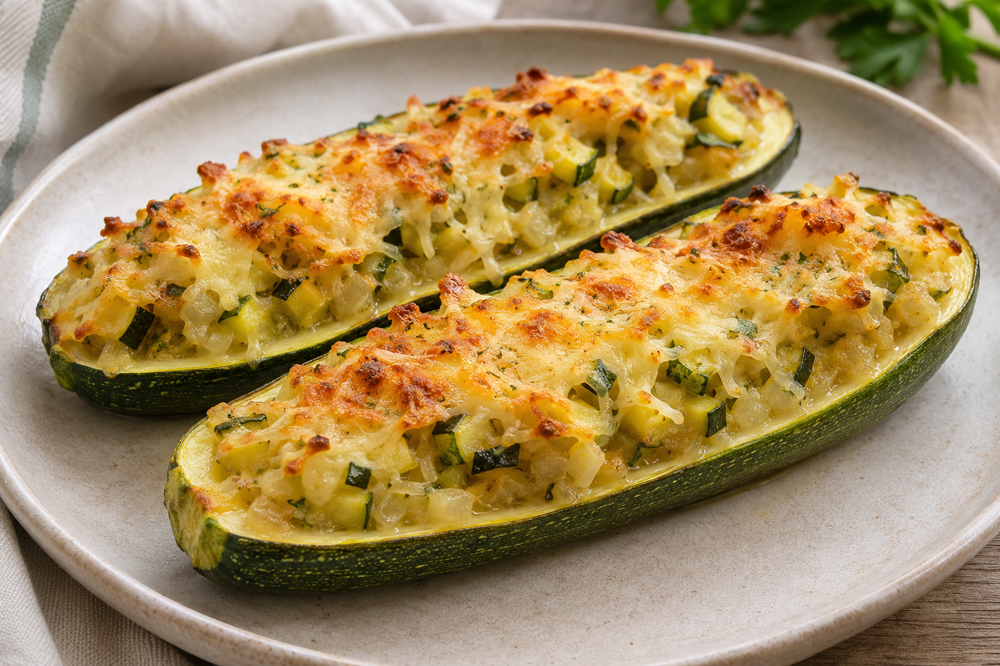

# Calabacines rellenos

**Receta:** 32 · **Chef:** Abuela Loli · **Raciones:** 4 · **Dificultad:** media · **Tiempo:** ~60 min

## Ingredientes

Para 4 personas; cantidades y tiempos orientativos, salvo el huevo.

- Calabacines medianos: ~4
- Huevo: 1
- Cebolla: ~1
- Puerro (opcional): ~1
- Atún escurrido o jamón cocido: ~160 g o ~150 g
- Pan rallado: ~3 cucharadas
- Queso rallado: ~80 g
- Aceite de oliva: ~2 cucharadas
- Sal: al gusto

## Elaboración

1. Lava los calabacines y cuécelos enteros en agua hasta que estén tiernos pero firmes, durante ~15-20 minutos. Escúrrelos y deja que se templen.
2. Córtalos por la mitad a lo largo y colócalos con la parte cortada hacia arriba en una bandeja. Retira la pulpa con cuidado de conservar la piel y escúrrela bien.
3. Pica la cebolla y, si lo usas, el puerro. Sofríelos en una sartén con aceite hasta que estén tiernos. Precalienta el horno a 180 °C.
4. Bate el huevo en un bol. Añade la pulpa escurrida, la cebolla, el puerro si lo usas y el atún escurrido o el jamón cocido picado. Incorpora el pan rallado y mezcla.
5. Rellena las mitades de calabacín y espolvorea el queso rallado. Hornea a 180 °C hasta que el relleno esté bien caliente y cuajado y el queso dorado, durante ~15-20 minutos.

## Consejos

- Las cantidades y los tiempos son orientativos; ajusta la cocción al tamaño de los calabacines.
- Elige atún o jamón cocido; el puerro es opcional.
- Contiene huevo, leche y gluten; la versión con atún contiene pescado.
