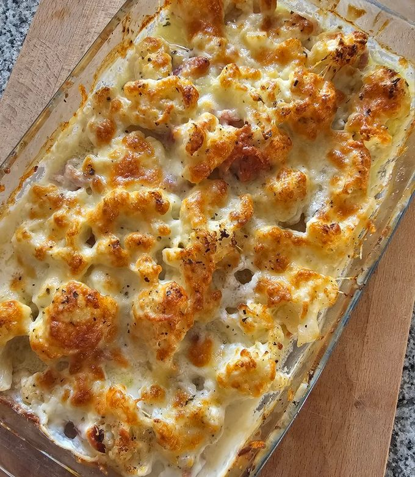

# Coliflor al horno con bacon y queso

**Receta:** 2 · **Chef:** Javi · **Raciones:** 4 o 6 · **Dificultad:** fácil · **Horno:** 30 min

## Ingredientes

| Ingrediente | 4 personas | 6 personas |
|---|---:|---:|
| Coliflor, limpia | 1 kg | 1,5 kg |
| Beicon en taquitos | 150 g | 225 g |
| Queso Grana Padano | 100 g | 150 g |
| Aceitunas negras sin hueso | 80 g | 120 g |
| Aceite de oliva | 4 cucharadas | 6 cucharadas |
| Limón | ½ unidad | ¾ de unidad |
| Comino | ½ cucharadita | ¾ de cucharadita |
| Pimentón de la Vera (opcional) | ½ cucharadita | ¾ de cucharadita |
| Guindilla (opcional) | Al gusto | Al gusto |
| Sal y pimienta | Al gusto | Al gusto |

Las cantidades son orientativas: la receta original no las especifica, salvo el zumo de medio limón para el aliño.

## Elaboración

1. Precalentar el horno a 220 °C. Cortar la coliflor en trozos de bocado, lavarla y escurrirla bien. Untar una fuente apta para horno con un poco de aceite y repartir la coliflor.
2. Aliñar con aceite, sal y pimienta. Hornear durante 15 minutos a media altura.
3. Sacar la fuente y añadir el beicon, el Grana Padano en trozos y el comino. Hornear otros 15 minutos en la parte superior, hasta que la coliflor esté tierna y dorada y el beicon cocinado.
4. Mientras, mezclar en un bol el aceite restante, las aceitunas negras troceadas y el zumo de limón. Si se desea, añadir guindilla desmenuzada y pimentón de la Vera.
5. Sacar la fuente del horno y aliñar la coliflor con la mezcla. Servir caliente.

## Consejos

- Repartir la coliflor en una sola capa para favorecer que se dore; usar dos fuentes si hace falta.
- Ajustar la sal al final: el beicon, el queso y las aceitunas ya aportan sal.
- Los 30 minutos corresponden al horno; hay que añadir el tiempo de preparación. El tiempo de cocción puede variar según el horno y el tamaño de los trozos.
