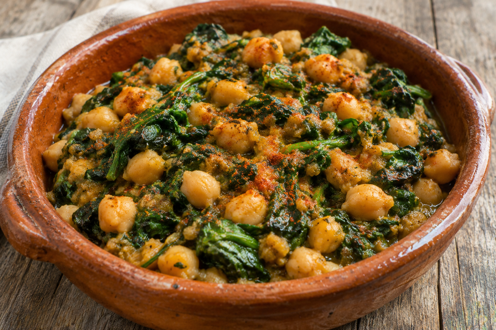

# Espinacas con garbanzos

**Chef:** Abuelo Juanmi  
**Raciones:** ~4, según el tamaño del tarro y la bolsa  
**Dificultad:** Fácil  
**Tiempo:** ~30 min

## Ingredientes

- 1 tarro de garbanzos cocidos
- 1 bolsa de espinacas frescas
- 3 o 4 rebanadas de pan
- Ajo, al gusto
- 1 pastilla de Avecrem
- Agua, un poco
- Aceite de oliva, al gusto
- Pimentón dulce, al gusto
- Sal, al gusto

## Elaboración

1. Lava las espinacas si es necesario, rehógalas en una sartén con un poco de aceite y resérvalas.
2. Fríe el pan y los ajos juntos en aceite. Pásalos a un recipiente con un poco de agua y la pastilla de Avecrem; tritura con la batidora hasta obtener una salsa.
3. Escurre los garbanzos cocidos. Mezcla en una sartén las espinacas, los garbanzos y la salsa triturada.
4. Añade pimentón dulce y sal. Deja cocinar un rato a fuego suave, removiendo, y sirve caliente.

## Consejos

- El número de raciones depende del tamaño del tarro y de la bolsa; los ~30 minutos son orientativos.
- Prueba antes de añadir sal, ya que la pastilla de caldo y los garbanzos pueden contenerla.
- Añade un poco de agua si la mezcla queda demasiado espesa.
