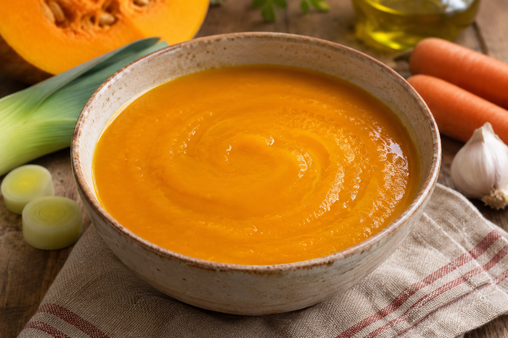

# Sopa de Calabaza

**Receta:** 28 · **Chef:** Patri · **Raciones:** 4 · **Dificultad:** fácil · **Tiempo:** ~40 min

## Ingredientes

| Ingrediente | 4 raciones |
|---|---:|
| Calabaza limpia | 800 g |
| Puerro | 1 unidad |
| Zanahorias | 2 unidades |
| Ajo | 2 dientes |
| Aceite de oliva | 2 cucharadas |
| Agua | Para cubrir |
| Sal | Al gusto |

## Elaboración

1. Pela la calabaza y las zanahorias. Limpia el puerro, retirando las raíces y las hojas exteriores, y lávalo bien. Trocea todas las verduras.
2. Pela y corta los ajos. Calienta el aceite en una cazuela y fríelos a fuego medio, removiendo, hasta que empiecen a dorarse.
3. Añade la calabaza, el puerro y las zanahorias. Cubre las verduras con agua y añade sal al gusto.
4. Lleva a ebullición y cocina a fuego suave durante ~20–25 minutos, hasta que las verduras estén tiernas.
5. Tritura con cuidado hasta obtener una textura uniforme. Ajusta la sal y, si es necesario, añade un poco de agua caliente. Sirve la sopa caliente.

## Consejos

- Las cantidades y los tiempos son orientativos.
- Para ajustar la textura, reserva un poco del agua de cocción y añádela después de triturar si hace falta.
- Deja templar un poco antes de triturar y sigue las instrucciones de tu batidora para líquidos calientes.
