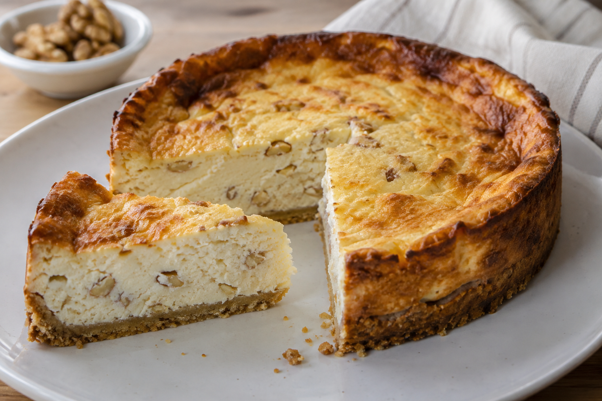

# Tarta de Queso

**Chef:** ELA  
**Raciones:** ~8  
**Dificultad:** Fácil  
**Tiempo:** ~60-75 min, más enfriado

Las raciones y el tiempo son orientativos; el tiempo de horno depende del molde y del horno.

## Ingredientes

### Base

- ~30 galletas
- 200 g de mantequilla

### Relleno

- 250 g de requesón (1 bote)
- 3 huevos
- 1 bote pequeño de leche condensada
- 200 g de nueces

## Elaboración

1. Precalienta el horno a 180 °C. Tritura las galletas y resérvalas.
2. Derrite la mantequilla en el microondas en intervalos cortos. Mézclala con las galletas y extiende la mezcla sobre la base del molde, presionando para compactarla.
3. Bate el requesón, los huevos, la leche condensada y las nueces hasta integrar el relleno. Viértelo sobre la base de galletas.
4. Hornea a 180 °C hasta que, al pinchar el centro con un cuchillo, la punta salga limpia. Como referencia, comprueba el punto a partir de ~40 minutos.
5. Deja enfriar la tarta y refrigérala antes de servir.

## Consejos

- El tiempo de cocción es orientativo: comprueba el centro antes de sacar la tarta.
- Conserva la tarta refrigerada.
